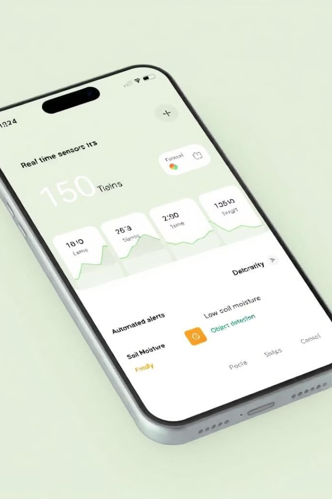
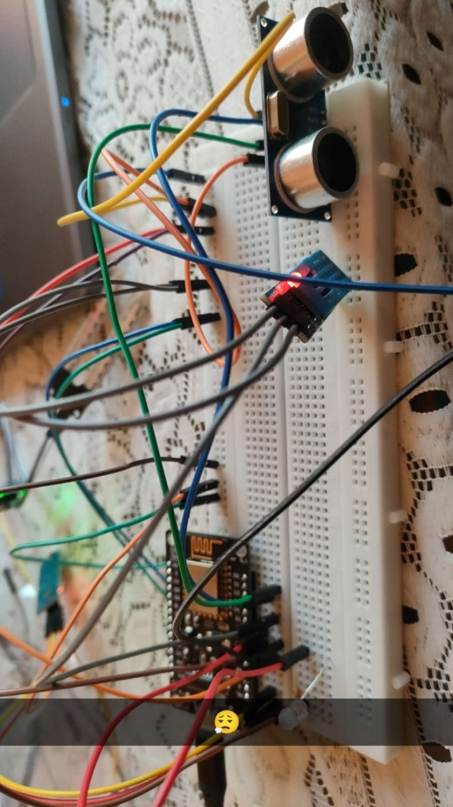
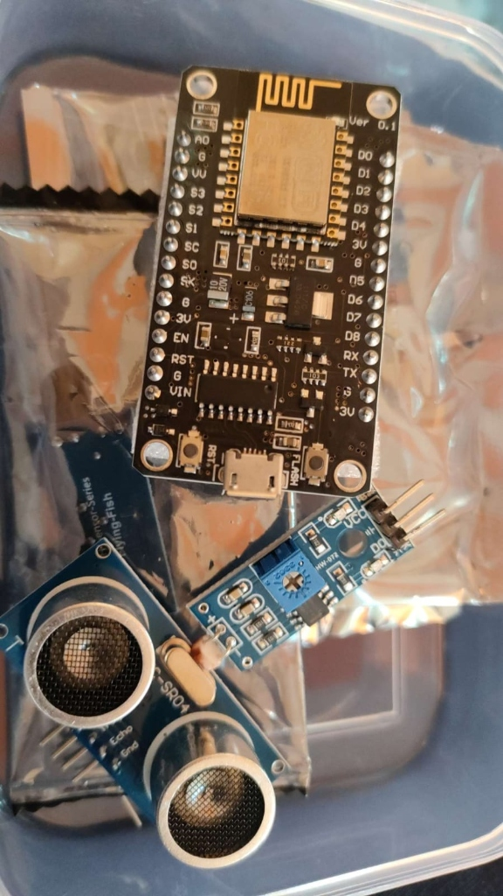
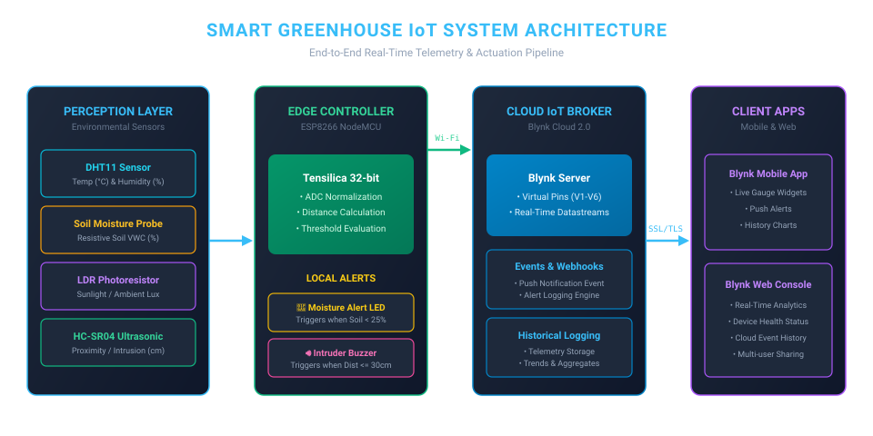
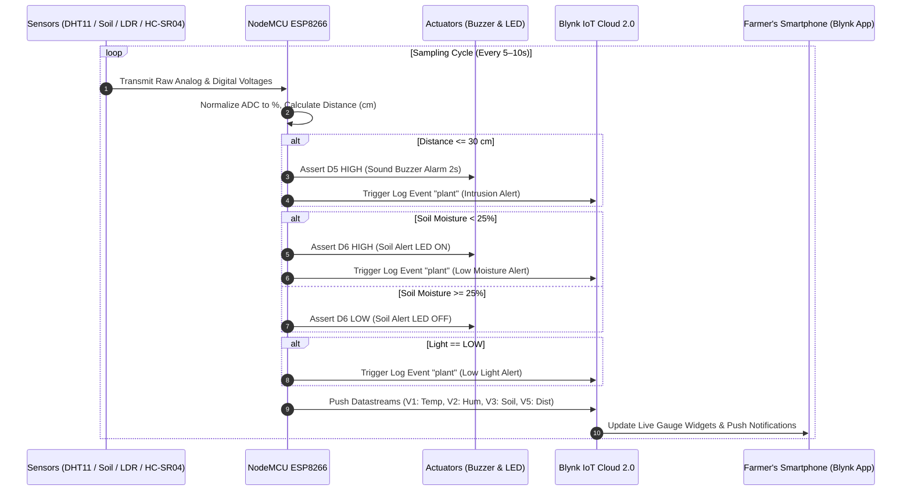

<div align="center">

# 🌱 Smart Greenhouse IoT System for Real-Time Monitoring and Alert

[](https://www.espressif.com/)
[](https://www.arduino.cc/)
[](https://blynk.io/)
[-00599C?style=for-the-badge&logo=c%2B%2B&logoColor=white)](https://isocpp.org/)
[](LICENSE)

An intelligent, low-cost Internet of Things (IoT) greenhouse and plant care system designed to autonomously monitor microclimatic conditions, detect physical intrusion, and push real-time alerts to farmers and botanists via the Blynk cloud platform.

<p align="center">
  
  
</p>

---

[Project Overview](#-project-overview) •
[Evidence & Photos](#-hardware-prototype-evidence) •
[Circuit & Schematics](#-circuit-diagram--pin-mapping) •
[System Architecture](#-system-architecture) •
[Blynk Setup](#-blynk-iot-cloud-configuration) •
[Installation](#-getting-started--installation) •
[Academic Details](#-academic-credits)

</div>

---

## 📖 Project Overview

Greenhouses and modern agricultural facilities require stringent control over environmental parameters—temperature, atmospheric humidity, soil volumetric water content, illumination, and perimeter security. Manual record-keeping is labor-intensive, slow to respond, and vulnerable to human oversight.

The **Smart Greenhouse IoT System** provides a continuous, automated solution powered by the **NodeMCU ESP8266** microcontroller. The system gathers sensor telemetry every cycle, evaluates risk conditions in real time, and broadcasts data to the **Blynk Cloud 2.0** ecosystem. When adverse parameters occur (e.g., dry soil, low illumination, or wildlife intrusion), local auditory and visual alarms activate simultaneously with mobile push alerts.

### 🌟 Key Features

- **🌡️ Microclimate Monitoring:** Real-time temperature (°C) and relative humidity (%) via a calibrated DHT11 sensor.
- **💧 Soil Moisture Sensing:** Analog volumetric water content normalization (0–100%) to safeguard against under-watering.
- **☀️ Sunlight / Illumination Tracking:** Light-Dependent Resistor (LDR) optical detection for ambient lux threshold compliance.
- **🛡️ Perimeter & Intruder Defense:** HC-SR04 ultrasonic sonic echo proximity detection to warn against wildlife or pest intrusions within 30 cm.
- **🚨 Multi-Channel Alerting:** 
  - On-site active Piezo buzzer alarm for proximity warnings.
  - High-visibility LED indicator for critical moisture levels (< 25%).
  - Instant push notifications sent to smartphones via the Blynk IoT app.
- **🌐 Cloud Connectivity:** Over-The-Air telemetric streaming over 2.4 GHz IEEE 802.11 b/g/n Wi-Fi.

---

## 📸 Hardware Prototype Evidence

Real-world implementation of the prototype developed and tested in the laboratory:

<div align="center">
  <table>
    <tr>
      <td align="center" width="50%">
        
        <br/>
        <b>Figure 1: Fully Wired Working Hardware Prototype</b>
        <br/>
        <i>NodeMCU ESP-12E, DHT11 (operational status LED), HC-SR04 ultrasonic sensor, LDR module, and common rail wiring.</i>
      </td>
      <td align="center" width="50%">
        
        <br/>
        <b>Figure 2: Core Hardware Modules</b>
        <br/>
        <i>NodeMCU v3 microcontroller board, HC-SR04 ultrasonic module, and adjustable LM393 LDR photosensor module.</i>
      </td>
    </tr>
  </table>
</div>

---

## ⚡ Circuit Diagram & Pin Mapping

Below is the connection schematic illustrating how each sensor and actuator connects to the ESP8266 NodeMCU development board:

<div align="center">
  
</div>

### 🔌 Pin Interfacing Table

| Component | Component Pin | NodeMCU Pin | GPIO | Signal Type | Description |
| :--- | :--- | :--- | :--- | :--- | :--- |
| **DHT11 Sensor** | DATA | `D4` | `GPIO 2` | Digital I/O | Temperature & Humidity Readings |
| **Soil Moisture Sensor** | AOUT | `A0` | `ADC 0` | Analog Input | Voltage proportional to soil water content |
| **LDR Module** | DO (Digital Out) | `D0` | `GPIO 16` | Digital Input | High/Low optical threshold indicator |
| **HC-SR04 Ultrasonic** | TRIG | `D7` | `GPIO 13` | Digital Output | 10µs ultrasonic burst trigger pulse |
| **HC-SR04 Ultrasonic** | ECHO | `D8` | `GPIO 15` | Digital Input | Measures sound round-trip travel time |
| **Active Piezo Buzzer** | POS (+) | `D5` | `GPIO 14` | Digital Output | Emits acoustic alert on intrusion (≤ 30 cm) |
| **Alert Indicator LED** | ANODE (+) | `D6` | `GPIO 12` | Digital Output | Illuminates when soil moisture drops below 25% |
| **Power Bus (Sensors)** | VCC | `3V3` / `VU` | — | Power Rail | 3.3V for DHT11/Soil/LDR; 5V (VU) for HC-SR04 |
| **Common Ground** | GND | `G` | — | Ground Rail | Shared ground reference across all components |

---

## 🏗️ System Architecture

The project employs a modular four-tier IoT architecture spanning the physical perception layer to user-facing applications:

<div align="center">
  
</div>



---

## ☁️ Blynk IoT Cloud Configuration

The firmware is designed for **Blynk IoT 2.0**. Ensure your Blynk console template matches these specifications:

### 1. Template Settings
- **Template ID:** `TMPL3zUiMuQij`
- **Template Name:** `NODEMCU`
- **Hardware:** `ESP8266`
- **Connection Type:** `WiFi`

### 2. Virtual Datastreams Setup

| Virtual Pin | Datastream Name | Data Type | Min Value | Max Value | Default Unit | Purpose |
| :---: | :--- | :---: | :---: | :---: | :---: | :--- |
| **V1** | Temperature | Double / Float | `0` | `60` | `°C` | Ambient greenhouse temperature |
| **V2** | Humidity | Double / Float | `0` | `100` | `%` | Relative humidity percentage |
| **V3** | Soil Moisture | Integer | `0` | `100` | `%` | Normalized moisture level |
| **V4** | Light Intensity | String / Int | `0` | `1` | — | Sunlight detection status |
| **V5** | Distance | Integer | `0` | `400` | `cm` | Proximity to crops / boundaries |
| **V6** | Soil Moisture Alert | Integer | `0` | `1` | — | Visual indicator state in app |

### 3. Events & Notifications
- **Event Code:** `plant`
- **Event Type:** `Warning`
- **Notification Type:** Push Notification & Timeline Log
- **Message Templates:**
  - `Low Soil Moisture: {val}%`
  - `Object or animal detected near the plant! Distance: {val} cm`
  - `Low Light Detected!!!`

---

## 💻 Firmware Implementation

The firmware source code is available in the [`src/`](src/) directory:
- [`src/smart_greenhouse_iot.ino`](src/smart_greenhouse_iot.ino): Standard implementation featuring serial telemetry, automatic normalization, and direct alert handling.
- [`src/smart_greenhouse_iot_timer_optimized.ino`](src/smart_greenhouse_iot_timer_optimized.ino): Non-blocking production build utilizing `BlynkTimer` to maintain high network stability without blocking delays.
- [`src/config.h.example`](src/config.h.example): Credential header template for keeping personal authentication tokens and Wi-Fi credentials secure.

### Soil Moisture Normalization Logic
The analog soil probe reads raw ADC counts ranging from `0` (saturated water) to `1023` (completely dry air). The firmware converts this inverted value into a plant-friendly percentage:

$$\text{Moisture Percentage (\%)} = \text{constrain}\left(\operatorname{map}(\text{rawADC}, 1023, 0, 0, 100), 0, 100\right)$$

### Proximity Calculation Formula
The HC-SR04 distance measurement utilizes ultrasonic acoustic travel time in air ($\approx 343\text{ m/s}$ or $0.034\text{ cm/µs}$):

$$\text{Distance (cm)} = \frac{\Delta t_{\text{pulseIn}} \times 0.034}{2}$$

---

## 🚀 Getting Started & Installation

### Prerequisites
1. **Hardware Components:**
   - 1× NodeMCU ESP8266 (ESP-12E)
   - 1× DHT11 Temperature & Humidity Sensor
   - 1× Resistive Soil Moisture Sensor with LM393 Comparator
   - 1× LDR Photoresistor Module
   - 1× Ultrasonic Sensor (HC-SR04)
   - 1× 5V Active Piezo Buzzer
   - 1× 5mm Red Alert LED & 220Ω Resistor
   - 1× Solderless Breadboard & Male-to-Male / Male-to-Female Jumper Wires
   - 1× Micro-USB Cable for programming and power

2. **Software Environment:**
   - [Arduino IDE](https://www.arduino.cc/en/software) (version 1.8.x or 2.x)
   - ESP8266 Board Package for Arduino IDE:
     ```
     http://arduino.esp8266.com/stable/package_esp8266com_index.json
     ```
   - Required Arduino Libraries (Install via Library Manager):
     - `Blynk` by Volodymyr Shymanskyy
     - `DHT sensor library` by Adafruit
     - `Adafruit Unified Sensor` by Adafruit

### Flashing Procedure
1. Clone the repository:
   ```bash
   git clone https://github.com/Akhilcrab/smart-greenhouse-iot-system.git
   cd smart-greenhouse-iot-system
   ```
2. Open [`src/smart_greenhouse_iot.ino`](src/smart_greenhouse_iot.ino) in Arduino IDE.
3. Update the network and authentication definitions:
   ```cpp
   #define BLYNK_TEMPLATE_ID "TMPL3zUiMuQij"
   #define BLYNK_TEMPLATE_NAME "NODEMCU"
   #define BLYNK_AUTH_TOKEN "YOUR_ACTUAL_BLYNK_TOKEN"

   char ssid[] = "YOUR_WIFI_SSID";
   char pass[] = "YOUR_WIFI_PASSWORD";
   ```
4. Under **Tools > Board**, select **NodeMCU 1.0 (ESP-12E Module)**.
5. Select the matching **Port** (e.g., `COM3` on Windows or `/dev/ttyUSB0` on Linux).
6. Click **Upload** and open the Serial Monitor at **9600 baud** to confirm initialization.

---

## 📊 Results & Experimental Observations

- **Response Latency:** Cloud telemetry was successfully transmitted with sub-second latency over 2.4 GHz Wi-Fi.
- **Moisture Threshold Accuracy:** When soil moisture dipped below 25%, the on-board D6 LED activated within 200 ms and generated an instant Blynk notification on the mobile client.
- **Intrusion Reliability:** The HC-SR04 ultrasonic echo detection responded reliably to movements within 30 cm, sounding the 2-second auditory buzzer alarm and logging the incident.
- **Sensor Calibration Note:** Standard resistive soil moisture probes require initial field calibration based on local soil composition (clay, loam, or sand) to ensure optimal watering schedules.

---

## 🔮 Future Enhancements

- [ ] **Automated Drip Irrigation:** Interface a 5V/12V relay module with a submerged water pump or solenoid valve for autonomous watering.
- [ ] **Expanded Chemical Sensing:** Incorporate analog NPK (Nitrogen, Phosphorus, Potassium), soil pH, and optical $CO_2$ sensors.
- [ ] **Predictive Machine Learning:** Train micro-edge models to forecast microclimatic trends and disease likelihood.
- [ ] **Solar Energy Harvesting:** Integrate a 5V/18V solar cell with a TP4056 lithium battery charger for off-grid deployment.
- [ ] **Voice Assistant Integration:** Add voice telemetry triggers with Google Assistant and Amazon Alexa.

---

## 🎓 Academic Credits

This project was developed as a university engineering mini-project:

- **Project Title:** Smart Greenhouse IoT System for Real-Time Monitoring and Alert
- **Student Name:** Akhil Rawat
- **University Roll No.:** 2318259
- **Class Roll No.:** 09
- **Section:** E1
- **Program:** Bachelor of Technology (B.Tech) in Computer Science & Engineering
- **Semester:** III (Third Semester)
- **Institution:** [Graphic Era Hill University](https://www.gehu.ac.in/), Dehradun Campus, Uttarakhand, India
- **Faculty Supervisor / Co-ordinator:** Mr. Shushant Chamoli
- **Date of Submission:** 10/01/2025

📄 Project Documentation:
- Full Academic Report: [docs/Smart_Greenhouse_IoT_Report.pdf](docs/Smart_Greenhouse_IoT_Report.pdf)
- Presentation Slides: [docs/Smart_Greenhouse_Presentation.pptx](docs/Smart_Greenhouse_Presentation.pptx)

---

## 📜 License

This project is open-source and distributed under the terms of the [MIT License](LICENSE). Feel free to use, modify, and build upon this project for educational and research initiatives.
